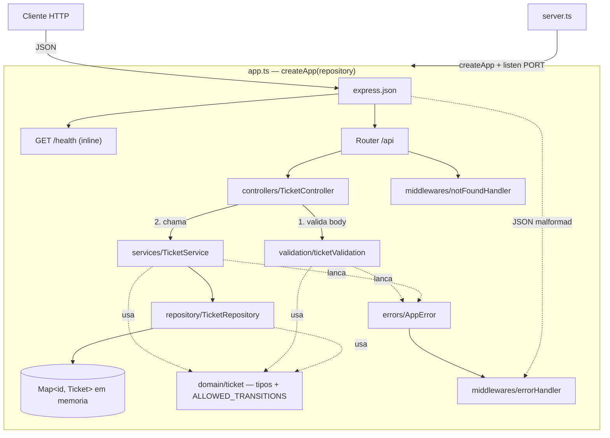
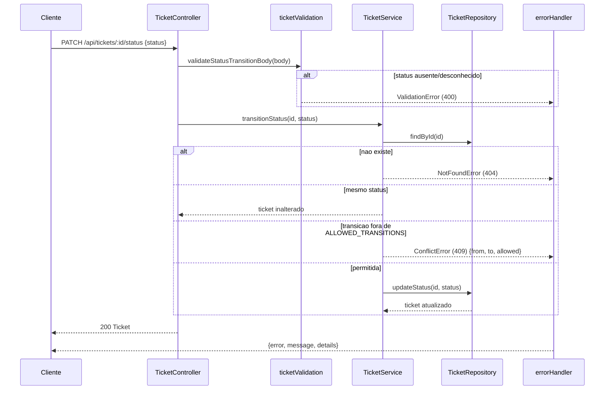
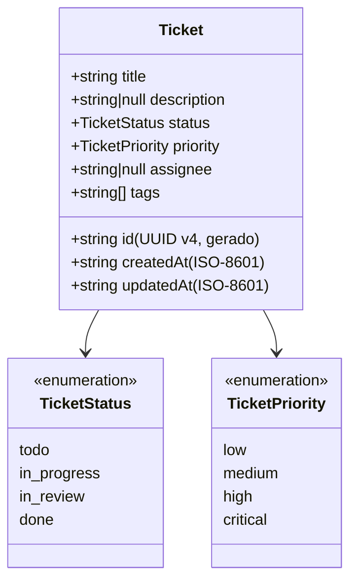
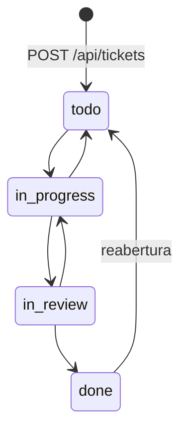

# SDD As-Built — Ticket Manager API v1.0.0

Este documento descreve o sistema **como implementado** na release v1.0.0, derivado
diretamente do codigo em `src/`. A especificacao original (intencao) esta em
[`SPEC.md`](SPEC.md); as diferencas entre as duas estao na secao
[7. Divergencias](#7-divergencias-em-relacao-a-especificacao-inicial).

## 1. Visao geral

API REST em Node.js/TypeScript (Express 4) para gestao de tickets, com armazenamento em
memoria por processo. Um unico processo HTTP; nao ha dependencias externas (banco,
fila, cache) nem autenticacao.

## 2. Arquitetura

Arquitetura em camadas ([ADR-0001](adr/0001-arquitetura-em-camadas.md)). Dependencias
apontam sempre "para dentro": controller -> service -> repository -> domain.
`validation` e chamada pelos controllers antes de qualquer acesso ao service;
`errors` e compartilhada por validation/service e consumida pelo middleware.



Fluxo de uma requisicao de transicao de status:



## 3. Componentes

| Componente | Arquivo | Responsabilidade real |
|---|---|---|
| Bootstrap | `src/server.ts` | Le `PORT` (padrao 3000), chama `createApp()` e `listen`. Excluido da cobertura. |
| Composicao | `src/app.ts` | `createApp(repository = new TicketRepository())`: registra `express.json()`, `/health`, rotas `/api`, `notFoundHandler` e `errorHandler`. O repositorio e injetavel (testes usam instancia nova por caso). |
| Controller | `src/controllers/ticketController.ts` | Metodos como arrow functions (bind implicito). Valida body via `validation`, monta `TicketFilters` a partir da query (sem validacao, ver secao 7), chama o service e define o status HTTP. |
| Validacao | `src/validation/ticketValidation.ts` | `validateCreateTicketInput`, `validateUpdateTicketInput`, `validateStatusTransitionBody` e validadores por campo. Acumula erros por campo e lanca um unico `ValidationError`. Faz `trim()` em `title`; ignora campos desconhecidos. |
| Service | `src/services/ticketService.ts` | Regras de negocio: existencia (404), maquina de estados (409), idempotencia de status, normalizacao de paginacao (`page` 1, `pageSize` 20). |
| Repositorio | `src/repository/ticketRepository.ts` | `Map` em memoria. Gera `id` (UUID v4) e timestamps; aplica defaults; filtra por igualdade exata; ordena por `createdAt` ascendente; pagina. |
| Dominio | `src/domain/ticket.ts` | `TICKET_STATUSES`, `TICKET_PRIORITIES`, `ALLOWED_TRANSITIONS`, interfaces `Ticket`, `CreateTicketInput`, `UpdateTicketInput`, `TicketFilters`. |
| Erros | `src/errors/AppError.ts` | `AppError(message, statusCode, details?)` e subclasses `ValidationError` (400), `NotFoundError` (404), `ConflictError` (409). |
| Middlewares | `src/middlewares/errorHandler.ts` | `errorHandler`: converte JSON malformado em `ValidationError`; serializa `AppError`; demais erros -> 500 com log. `notFoundHandler`: rota inexistente -> 404. |

## 4. APIs / Endpoints

Base path `/api` (exceto `/health`). Requisicoes e respostas em `application/json`.

### Formato de erro (todas as rotas)

```json
{ "error": "<NomeDoErro>", "message": "<mensagem em portugues>", "details": { } }
```

| HTTP | `error` | Quando |
|---|---|---|
| 400 | `ValidationError` | Body nao-objeto, JSON malformado, campo invalido, PATCH vazio, status desconhecido |
| 404 | `NotFoundError` | `id` inexistente ou rota desconhecida (`rota nao encontrada: <METODO> <path>`) |
| 409 | `ConflictError` | Transicao de status fora de `ALLOWED_TRANSITIONS` |
| 500 | `InternalServerError` | Erro nao previsto (sem `details`) |

### `GET /health`

Response `200`:
```json
{ "status": "ok", "timestamp": "2026-10-25T12:00:00.000Z" }
```

### `POST /api/tickets`

Request:
```json
{
  "title": "Configurar ambiente de CI",
  "description": "Pipeline com lint e testes",
  "priority": "high",
  "assignee": "ana",
  "tags": ["infra", "ci"]
}
```

| Campo | Obrigatorio | Regra | Default |
|---|---|---|---|
| `title` | sim | string, 3–120 caracteres apos `trim()` (o valor salvo e o aparado) | — |
| `description` | nao | string <= 2000 ou `null` | `null` |
| `priority` | nao | `low \| medium \| high \| critical` | `medium` |
| `assignee` | nao | string nao vazia <= 80 ou `null` | `null` |
| `tags` | nao | array de ate 10 strings de 1–30 caracteres | `[]` |

Campos desconhecidos (inclusive `status`, `id`) sao ignorados.

Response `201`: `Ticket` (ver secao 5).

Erro `400` (exemplo):
```json
{ "error": "ValidationError", "message": "falha de validacao",
  "details": { "title": "title e obrigatorio", "priority": "priority deve ser um dos valores: low, medium, high, critical" } }
```

### `GET /api/tickets`

Query (todos opcionais): `status`, `priority`, `assignee` (igualdade exata),
`page` (padrao 1), `pageSize` (padrao 20). Valores `<= 0` ou nao numericos usam o padrao.

Response `200`:
```json
{ "items": [ { "id": "...", "title": "...", "status": "todo", "...": "..." } ],
  "total": 1, "page": 1, "pageSize": 20 }
```
`total` e o numero de itens apos filtros e antes da paginacao. Ordenacao: `createdAt` ascendente.

### `GET /api/tickets/:id`

Response `200`: `Ticket`. Erro `404`: `{ "error": "NotFoundError", "message": "ticket <id> nao encontrado" }`.

### `PATCH /api/tickets/:id`

Request: subconjunto nao vazio de `{ title, description, priority, assignee, tags }`
(mesmas regras do POST; `status` nao e alteravel aqui e e ignorado).

Response `200`: `Ticket` atualizado (`updatedAt` renovado).
Erros: `400` (corpo `{}` -> `"corpo da requisicao vazio: informe ao menos um campo para atualizar"`, ou campo invalido), `404`.
A validacao do body ocorre **antes** da verificacao de existencia.

### `PATCH /api/tickets/:id/status`

Request: `{ "status": "in_progress" }`

Response `200`: `Ticket` com o novo status. Se `status` == status atual, retorna o
ticket inalterado (idempotente, `updatedAt` preservado).

Erro `409` (exemplo `todo -> done`):
```json
{ "error": "ConflictError", "message": "transicao de status invalida: 'todo' -> 'done'",
  "details": { "from": "todo", "to": "done", "allowed": ["in_progress"] } }
```
Erros: `400` (status ausente/desconhecido), `404`.

### `DELETE /api/tickets/:id`

Response `204` sem corpo. Erro `404` (inclusive em segunda remocao do mesmo id).

## 5. Modelo de dados



Armazenamento: `Map<string, Ticket>` dentro de `TicketRepository`. Estado perdido ao
reiniciar o processo ([ADR-0002](adr/0002-persistencia-em-memoria.md)).

Maquina de estados (`ALLOWED_TRANSITIONS` em `src/domain/ticket.ts`):



## 6. Decisoes tecnicas

| Decisao | Motivo | Referencia |
|---|---|---|
| Camadas controller/service/repository/domain + validation transversal | Testar regras sem HTTP; trocar persistencia sem tocar no service | ADR-0001 |
| Persistencia em memoria | Escopo focado em spec e testes; interface do repositorio pronta para adaptador real | ADR-0002 |
| `createApp(repository)` com injecao de dependencia | Isolamento entre testes de integracao (repositorio novo por caso) | `src/app.ts` |
| Erros de dominio como classes (`AppError`) + middleware central | Formato de erro unico (RNF01); controllers sem `try/catch` | `src/errors`, `src/middlewares` |
| Validacao manual (sem biblioteca de schema) | Poucas regras, zero dependencias extras, mensagens em portugues por campo | `src/validation` |
| Express 4 com handlers sincronos | Erros lancados em handlers sincronos chegam ao `errorHandler` sem wrapper async | `src/controllers` |
| Docker multi-stage (`deps`, `test`, `build`, `runtime`) | Imagem final so com deps de producao e usuario nao-root; mesmo Dockerfile roda os testes | `Dockerfile` |
| Servico `test` no compose com `profiles: [test]` | `docker compose up` sobe so a API; `docker compose run --rm test` roda a suite | `docker-compose.yml` |
| CI com job `docker` | Valida build das imagens, testes em container e smoke test via `compose up` | `.github/workflows/ci.yml` |
| Agente Claude Code guiado por `CLAUDE.md` | Fluxo SDD reprodutivel | ADR-0003 |

## 7. Divergencias em relacao a especificacao inicial

| # | Especificacao (`SPEC.md`) | Implementacao v1.0.0 | Situacao |
|---|---|---|---|
| D1 | RNF02: toda entrada invalida -> 400 | JSON malformado retornava **500**. Corrigido: agora `400 ValidationError` com `details.body = "JSON malformado"`. | Corrigido na v1.0.0 e registrado em SPEC secao 7 |
| D2 | RNF02 / RF03: filtros de listagem | `status`/`priority` invalidos na query **nao** sao validados -> `200` com lista vazia. `page`/`pageSize` invalidos caem nos padroes; **sem limite maximo** de `pageSize`. | Aceito como as-built; registrado em SPEC secao 7 (trabalho futuro) |
| D3 | Contrato nao define ordenacao nem padroes de paginacao | Ordenacao por `createdAt` ascendente; padroes `page=1`, `pageSize=20` | Detalhe de implementacao nao previsto na spec |
| D4 | RN03 cita `GET`, `PATCH`, `DELETE` em id inexistente -> 404 | Em `PATCH`, a validacao do body ocorre antes: body invalido em id inexistente -> **400** | Ja registrado em SPEC secao 7 (2026-09-14) |
| D5 | RN02 original nao previa mesmo status | Transicao para o status atual e idempotente (200, sem alterar `updatedAt`) | Ja registrado em SPEC secao 7 (2026-09-14) |
| D6 | Spec nao cita rotas desconhecidas | Qualquer rota fora do contrato -> `404 NotFoundError` com `rota nao encontrada: <METODO> <path>` | Comportamento adicional |
| D7 | RN01 fala em tamanho de `title` | `title` e aparado (`trim()`) antes de validar e de salvar; `description`, `assignee` e `tags` **nao** sao aparados | Detalhe de implementacao |
| D8 | Contrato de entrada | Campos desconhecidos no body sao ignorados silenciosamente (inclusive `status` no POST/PATCH) | Detalhe de implementacao |
| D9 | `:id` | `id` nao e validado como UUID; qualquer valor inexistente -> 404 | Detalhe de implementacao |
| D10 | RNF03: ambiente via Docker | Alem da API, ha um servico `test` no compose e um job `docker` no CI | Ampliado na v1.0.0 |
| D11 | — | Removidos codigos mortos: `TicketRepository.clear()` e singleton `ticketRepository` | Higienizacao v1.0.0, registrado em SPEC secao 7 |

## 8. Qualidade e evidencias

- 52 testes (2 suites unitarias + 1 de integracao), 100% aprovados.
- Cobertura total: 91.2% statements, 79.2% branches, 97.72% functions, 93.04% lines
  (limiares: 80/70/80/80).
- Evidencias: [`evidencias/test-report.txt`](evidencias/test-report.txt),
  [`evidencias/coverage-summary.txt`](evidencias/coverage-summary.txt).

## 9. Limitacoes conhecidas / trabalho futuro

- Persistencia real (ex: Postgres) — estado atual e perdido no restart.
- Autenticacao/autorizacao.
- Validacao estrita da query string de listagem e limite maximo de `pageSize` (D2).
- Escalonamento horizontal impossivel enquanto o estado for por processo.
